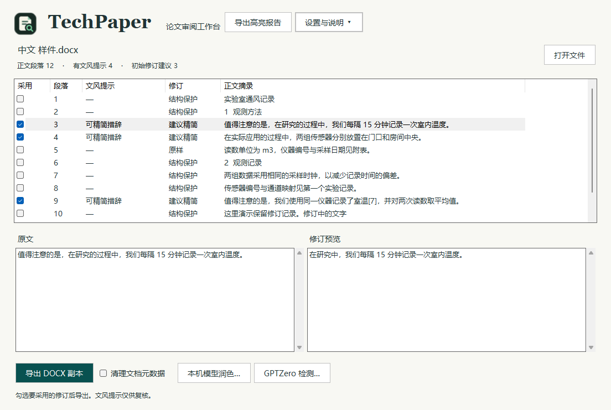

# TechPaper

**Windows 离线论文审阅工作台 · 0.9.0-preview.26**

拖入论文、幻灯片或扫描图，导出带原文高亮和出处的 HTML。DOCX 还可逐段对照修订，保留原稿并另存新文件。界面提供简体中文、亮色、暗色和跟随系统外观。

[下载预览版](https://github.com/Zeruik/TechPaper/releases/tag/v0.9.0-preview.26) · [验证记录](docs/VALIDATION.md) · [研究与方法](docs/RESEARCH.md) · [使用条款](docs/TERMS.txt) · [MIT 许可](LICENSE)

## 安装和使用

1. 在 Windows 10/11 x64 运行 TechPaper-Setup-0.9.0-preview.26.exe。阅读并同意条款，选择目录，按需勾选桌面快捷方式。安装范围为当前用户。安装器未作商业代码签名。可用 Get-FileHash 对照发行页 SHA256SUMS.txt。
2. 选“打开文件”或拖入单个 DOCX、PPTX、PDF、PNG、JPG。Canva 导出的 PNG/JPG 可直接导入。安装目录 tests/sample.docx 是含表格、图片、修订、编号及引用角标的合成样件。
3. 选“导出高亮报告”，指定新的 HTML 路径。提取及 OCR 在本机执行，运行时可取消。报告可在断网浏览器中打开。Ctrl+O 打开文件，Ctrl+R 导出报告，Esc 取消正在生成的报告。
4. 对 DOCX 选择段落，查看原文和修订预览。规则精简建议和本机模型建议起初均未勾选。请勾选要采用的段落。点击“导出 DOCX 副本”，指定新文件名。原稿及已有文件受覆盖保护。
5. “设置与说明”提供关于页、外观、本地 TXT 语料和润色提示词。外观与提示词保存到当前 Windows 用户的 LocalAppData/TechPaper/preferences.txt。通过“已安装的应用”卸载。

## 报告怎么读

| 报告信息 | 范围 |
| --- | --- |
| 写作信号 | 公开安装版使用透明基线 0.2.1。按句匹配预定义的模板表达、第一人称观测表述与数字。生成文本也可出现这些线索。AI、MIX、HUMAN 均为低置信线索；短句、线索不足时弃答。没有经过概率校准。 |
| 本地语料命中 | 通过设置选择自己的 UTF-8 TXT，报告列出每个互不重叠且至少 16 个字符的精确匹配，附源文件名、语料位置和段内位置。未选择语料时显示未选择。没有网络文献库或语义查重。 |
| 位置和覆盖 | 标注 DOCX 部件和段序、PPTX 幻灯片和段序、PDF 页码与可用坐标、图像 OCR 行框。重复句通过位置区分。报告列出已分类、弃答、低置信和跳过数量。 |
| OCR | 安装包内置 RapidOCR、PP-OCRv4 中英文识别权重、ONNX Runtime 及 PDFium，无需下载语言包。OCR 框以原图或渲染图像素计，识别分数低于 0.75 时跳过分类。多栏、竖排、表格和复杂图像需要复核阅读顺序。 |
| 在线 GPTZero | DOCX 的主文档段落可通过按钮显式发送。先预览发送文本，再输入自己的 Key 或读取 GPTZERO_API_KEY。显示服务版本和整篇三类概率。套餐和字符数限制由第三方设定。该程序独立于 GPTZero。 |

单独导入 JPEG 时，OCR 读序和行框以应用 EXIF 方向后的显示图像为准。透明图片按白底合成再识别，完全透明区域不提供正文；报告标注此背景选择。

PDF 优先读取文字层。纯扫描页按 144 dpi 渲染识别；主分支还对混合页的顶层位图区域做 OCR，按整页 144 dpi 像素定位。preview.6 将嵌套表单的位图位置映射回整页再识别（按 PDF 引擎默认遍历深度）；preview.1 安装包仅提示混合页有内嵌图像。PPTX 按演示文稿中的顺序读取文字和嵌入位图。报告列明放映时隐藏的整页和显式隐藏的对象，保留可见段落和图片在原稿中的序号。动画时序及图形遮挡仍需对照放映画面复核。DOCX 报告也读取表格、页眉、页脚及标准脚注/尾注的段落。嵌入图的坐标基于原始媒体，图形变换、图表内部数据、讲者备注或外链内容未完整解析。无文字时报告列出空白或失败位置。离线报告逐位置生成，无固定字符上限；单页、单图、单段、源索引及操作系统内存仍有资源上限。

## DOCX 润色及隐私

已有 Word 稿件直接打开，以保留原版式。纯文本可从「设置与说明 → 粘贴文本并自动分段」导入。输入框实时显示段数，按换行和句末连续编号的 H1、H2 等假设拆分，也支持句末或分号后的连续括号编号项，普通段落中的数字与引用随原句保留。同一行的引导句和连续编号的带标签假设可自动拆开，句末引用保留在前一项。长段落的两处改动分别高亮；不能精确对齐时，预览注明按范围标出。作者可以逐段比对、勾选并导出新 DOCX，或导出粘贴原文的高亮报告。「润色模式」可选择标准、扩展或扩展（双引文示例）；「查看内置润色提示词」可阅读当前模式的学术编辑要求，「润色提示词」可补充术语和语气偏好。

Word 编辑仅支持常规 Transitional DOCX。系统在原 OOXML 包中定点更新普通正文文本。保留文本运行的格式、段落属性、编号、行距、分节和超链接等结构；域、引用角标、脚注标记、修订记录、表格、公式及不安全段落受保护。普通文本中的引号、引用格式及参考文献区会影响可编辑范围。改字可能导致重新分页。DOCX 编辑器对解包大小设置 160 MiB 上限，超限文档仍可走报告流程。

规则模式断网可用。本地生成可选用 Ollama。在本机安装并启动服务、预先下载本地聊天模型，再从列表选择该机的模型。每个可处理段落只提交一次。多片段正文按原顺序提供上下文，引用等受保护文字仅供阅读；模型只能返回指定片段的修订。程序核对片段集合、片段交界标点和原有空格。批量润色跳过已勾选段落。点击“停止润色”或按 Esc 可中止当前请求，未完成的段落保留先前建议。本地模型不随安装包分发。可在 Ollama 启动环境设置 OLLAMA_NO_CLOUD=1，使用已下载权重。TechPaper 检查数值、常见单位及段落结构。作者仍须复核实体、引用对应、否定词及主张。

隐私清理默认关闭。开启后，导出前预览将涉及的核心及扩展属性、缩略图以及直接或通过样式隐藏的普通纯文字片段。默认保留批注及修订，其中的隐藏文字也会保留。额外勾选后才移除标准批注部件并匿名化修订者。自定义属性域的显示可能变化。图片 EXIF、嵌入对象、正文署名、外链、自定义 XML、域的缓存文字及含图片等对象的隐藏片段可能保留身份信息。已打开文档的编辑预览基于导入快照；若在外部重新保存原稿，请重新导入。

## 构建与测试

需要 Windows x64、系统 .NET Framework 4.7.2+、Python 3.12 x64 和 Inno Setup 6。完整构建首次从 PyPI 安装锁定依赖。终端用户运行安装包无需 Python。

~~~powershell
.\build.ps1 -Test -Iscc 'C:\Program Files (x86)\Inno Setup 6\ISCC.exe'
.\build\TechPaper.exe
.\build\worker-env\Scripts\python.exe tests\long_report.py
~~~

仅构建桌面编辑器可运行 build.ps1 -AppOnly -Test。报告需要运行 build-worker.ps1。build/dist/review-worker 是完整离线辅助进程目录。release 内生成安装器和 SHA-256 清单。安装目录 third-party 包含依赖和 OCR 权重的许可。主程序、图标与项目文档采用 MIT；第三方组件、公版原文和研究数据分别遵循各自条款。翻译研究语料不随源代码和安装包分发。

已构建离线辅助程序后，可用 .\build.ps1 -AppOnly -Test -DesktopTest 重跑桌面导入、取消与报告流程。

### preview.4 的使用与验证

DOCX 建议逐段并列显示原文和修订范围，勾选后才写入新的副本。可见展板按标题、左栏、右栏读取；含隐藏 OCR 文本的 PDF 以渲染结果为准。人工原作、译稿和生成稿的统计见验证记录。分类为实验性，Microsoft Word 桌面交互未测。安装包的实际离线测试见本版发行说明。

本版实测通过六种等价展板输入、冲突值取可见正文、两处重复定位、12000 段完整性和 DOCX 引用结构复核。检测能力未达标：中英文小样本均全部弃答。Microsoft Word 桌面实测和 Library 原始 ZIP 未测。[详细通过、失败与未测记录](docs/VALIDATION.md#090-preview4-验收范围)

### preview.5 的逐段确认

同一段内分开标出不同位置的改动，保留中间共同的引文、数值和文字背景。默认零项采用，勾选后导出新副本。超大差异区使用连续范围显示，以限制内存。

已从 GitHub 匿名下载 preview.5 安装器并核对 SHA-256。安装版在阻止出站通信时通过五种格式导入、六份等价 OCR 样件、12,000 段长文及确认一段后另存重开的测试。当前默认写作规则在新增中英同题测试中对 24/24 份全文弃答。实验分类器在非母语英语原稿中有明显误报，提高阈值又会漏掉生成稿，尚未启用。[公开安装器](https://github.com/Zeruik/TechPaper/releases/tag/v0.9.0-preview.5) · [详细指标与限制](docs/VALIDATION.md)

preview.7 导出 DOCX 高亮报告时，直接标记为隐藏的文字运行及删除、移出修订内的文字与图片均跳过，原件及其修订记录保留。通过样式继承的隐藏格式仍须另验。

preview.8 的本地模型润色将改动、原样和保护拦截分别计数，新增前后顺序、样品标签、浓度单位等常见反例检查。作者仍需逐段比较原文与建议。

本机润色使用 Ollama 明确的 :local 模型来源。先仅发送模型名确认本地信息，每次生成请求都指定本地来源；权重缺失、服务不支持该方式或模型标为云端时会停止。默认规则与 OCR 可在未安装 Ollama 的机器运行。[Ollama 云端与本机运行说明](https://docs.ollama.com/cloud)

点击「本机模型润色」后可选择已安装的 Ollama 模型。打开文档、规则润色和 OCR 均无需启动 Ollama。
